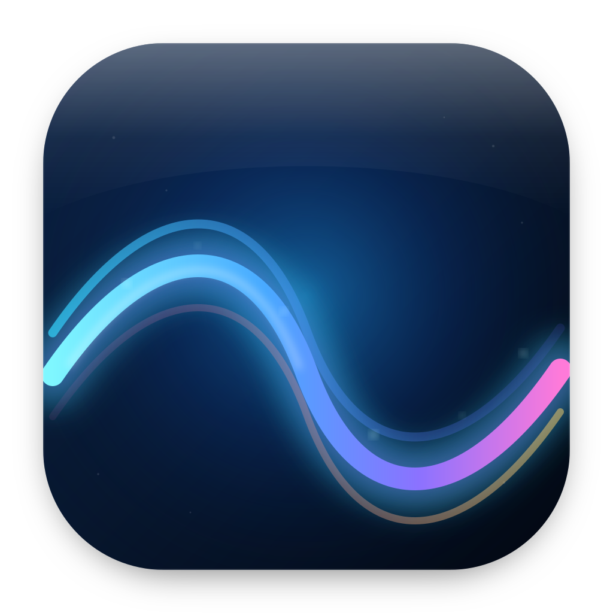
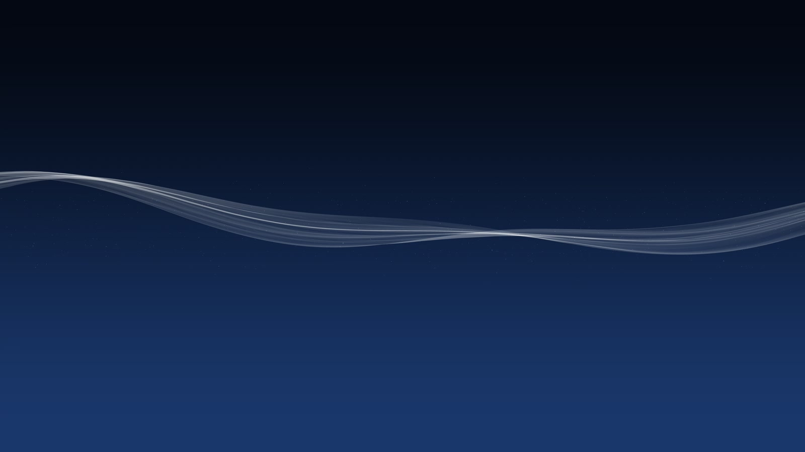
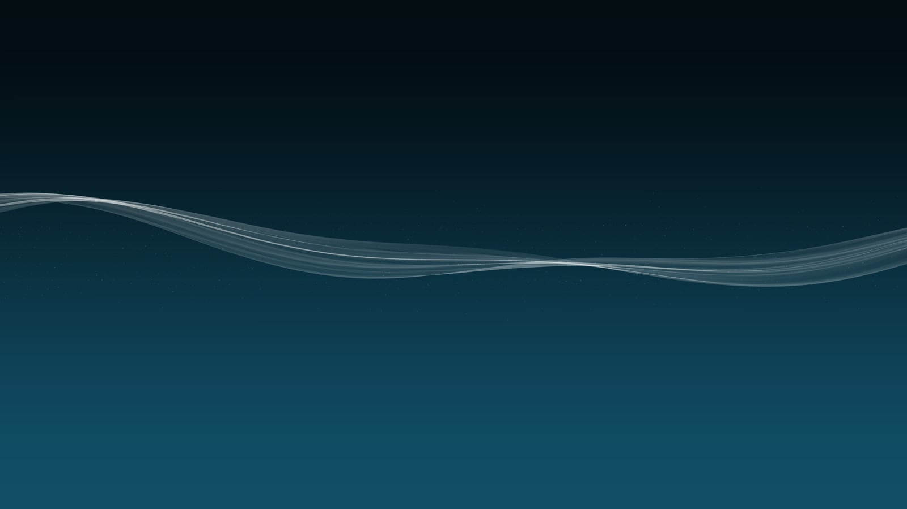
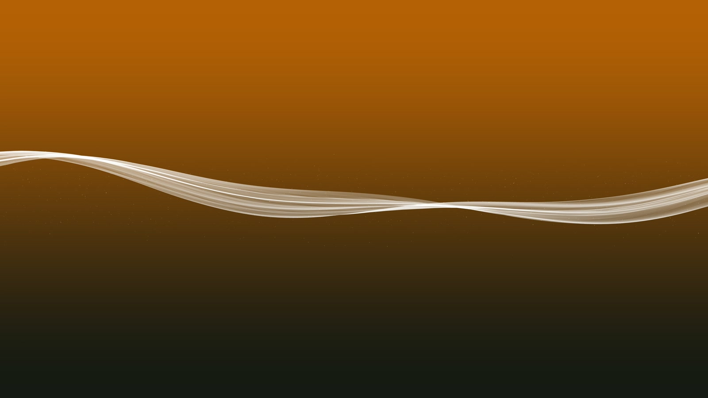

# OSXMB

<p align="center">
  
</p>

A native macOS menu-bar live wallpaper inspired by the PlayStation 3 XrossMediaBar wave. The renderer is written in Swift and Metal, uses no Sony artwork or firmware assets, and can export its own HEVC movie for the lock screen / Aerial catalog.

## Screenshots

| Midnight Blue | Ocean | November Night · Neon |
|:---:|:---:|:---:|
|  |  |  |

## Features

- Metal-rendered, click-through desktop wallpaper on every display.
- Menu-bar controls: pause, quick variants, anti-aliasing, sync lock screen now, launch at login, gallery.
- 364 variants: 3 original colors, a date-and-hour live seasonal theme, plus 12 months × day/night × 15 style families.
- Live Seasonal variant follows the supplied year-round color schedule, interpolates between date anchors, and scales brightness through the 24-hour table (full brightness at noon, black overnight).
- SwiftUI gallery with search, family filtering, and live hover previews.
- Anti-aliasing options: off, 2× MSAA, or 4× MSAA for both the live wallpaper and exported movies.
- 4K HEVC Main10 export at 3840×2160, 60 fps, with a 30 fps base temporal layer.
- `tscl` / `tsas` sample metadata so the Aerial player can perform its lock-screen slowed transition.
- Experimental installer for the per-user macOS 26 Aerial catalog, including manifest backup, `manifest.tar` patching, and a launch agent that re-adds the entry after catalog refreshes.
- Optional auto-sync: when the desktop variant changes, OSXMB exports the matching movie in the background and updates one stable **OSXMB Lock Screen** Aerial asset in place.

## Usage

OSXMB runs as an accessory app in the menu bar. Click the wave icon to:

- Choose an **Original** color, a live seasonal theme, or open the **OSXMB Gallery**.
- **Pause** or resume the live desktop rendering.
- Set **Anti-Aliasing** to Off, 2× MSAA, or 4× MSAA.
- Toggle **Auto-Sync Lock Screen** and watch progress in the status row.
- Run **Sync Lock Screen Now** to re-render the current variant, for example after changing anti-aliasing.
- **Export Lock Screen Movie…** to write a standalone HEVC file.
- **Install Into Aerial Catalog…** to update the experimental Aerial entry manually.
- Enable **Launch at Login** or quit the app.

### Lock Screen setup

1. Choose a variant in OSXMB and wait for **Lock Screen: Synced …** in the menu.
2. Open System Settings → Wallpaper → **Lock Screen** and select **OSXMB Lock Screen · &lt;variant&gt;**.
3. Change variants in OSXMB whenever you like. The same asset ID is updated in place, so the lock screen keeps using the existing selection.

macOS keeps separate Desktop and Lock Screen wallpaper choices. Selecting the OSXMB aerial only for Desktop will not make the lock screen follow it.

## Technical specs

| Component | Detail |
|---|---|
| Platform | macOS 14+, built and tested on Apple Silicon |
| Renderer | Swift, Metal, MetalKit; one transparent desktop-level window per display |
| Variants | 364: 3 originals, live seasonal, 12 months × day/night × 15 style families |
| Live animation | 60 fps Metal rendering with a 30-second seasonal brightness refresh |
| Anti-aliasing | Off, 2× MSAA, or 4× MSAA for both live rendering and export |
| Export codec | HEVC Main10, 3840×2160, 60 fps, 20 seconds / 1,200 frames |
| Temporal layers | 60 fps stream with a 30 fps base layer, `tscl` / `tsas` metadata |
| Auto-sync | Background 4K export, cancel/coalesce on rapid changes, stable Aerial asset ID |
| Aerial integration | Per-user `entries.json` + `manifest.tar` patching, catalog backup, refresh-guard launch agent |
| Preferences | `com.jonas.osxmb` (`antiAliasingMode`, `appliedVariantID`, `autoSyncLockScreen`, `paused`) |
| App icon | `OSXMB/Assets.xcassets/AppIcon.appiconset` with source art in `docs/images/icon.svg` |

## Build

Requirements: macOS 14+, Xcode 16+, and [XcodeGen](https://github.com/yonaskolb/XcodeGen).

```sh
brew install xcodegen
xcodegen generate
xcodebuild -project OSXMB.xcodeproj -scheme OSXMB -configuration Release -derivedDataPath build build
open "build/Build/Products/Release/OSXMB.app"
```

The Xcode project is generated, so run `xcodegen generate` after changing `project.yml` or adding source files. Build output is written to `build/` and ignored by Git.

The app is an accessory (`LSUIElement`), so it appears in the menu bar rather than the Dock. Use the wave icon to open the gallery or quit.

## Export and lock screen

Menu bar → **Export Lock Screen Movie…** writes a 4K HEVC Main10 `.mov`. The default export is 20 seconds (1,200 frames at 60 fps), so variant changes reach the lock screen quickly. Auto-sync uses the same 4K pipeline. Exports and the live wallpaper use the anti-aliasing mode selected in the menu (4× MSAA by default).

After export you can choose **Install Into Aerial Catalog…** from the completion dialog or from the menu bar. The installer:

1. Copies the movie to `~/Library/Application Support/com.apple.wallpaper/aerials/videos/<asset-id>.mov`.
2. Renders a 214×130 16-bit PNG thumbnail into `thumbnails/`.
3. Adds an asset and a **Landscapes → OSXMB** subcategory to `manifest/entries.json`.
4. Rewrites the `entries.json` member inside `manifest.tar` while preserving the other members.
5. Backs up the original catalog to `~/Library/Application Support/OSXMB/Backups/`.
6. Optionally restarts `WallpaperAgent` / `WallpaperAerialsExtension`.

This modifies a per-user Apple catalog and is experimental. macOS updates may refresh the catalog; a launch agent re-adds installed assets when the manifest changes.

### Auto-sync

Menu bar → **Auto-Sync Lock Screen** is on by default. When you choose a different variant, OSXMB renders the 20-second movie in the background and updates a single asset named **OSXMB Lock Screen · <variant>** in the Aerial catalog. The asset ID stays stable, so select it once in System Settings → Wallpaper; subsequent theme changes update the existing selection rather than adding new entries.

The 30-second live-seasonal brightness refresh does not trigger exports. Only an explicit variant change does. Rapid changes cancel and coalesce into the latest request. If the Aerial catalog is unavailable, auto-sync reports it in the menu and skips the export. Disable auto-sync from the same menu item. **Sync Lock Screen Now** re-renders the current variant without changing themes, which is useful after changing anti-aliasing.

Uninstall an asset with:

```sh
"build/Build/Products/Release/OSXMB.app/Contents/MacOS/OSXMB" --aerial-uninstall <asset-id>
```

### Testing helpers

```sh
OSXMB_EXPORT_SECONDS=2 \
  "build/Build/Products/Release/OSXMB.app/Contents/MacOS/OSXMB" \
  --export-test /tmp/osxmb.mov

"build/Build/Products/Release/OSXMB.app/Contents/MacOS/OSXMB" \
  --aerial-install /tmp/osxmb.mov original-midnight-blue

# Exercise auto-sync quickly with a 2-second movie.
OSXMB_AUTO_SYNC_SECONDS=2 \
  "build/Build/Products/Release/OSXMB.app/Contents/MacOS/OSXMB" --apply-live

# Apply the live seasonal theme at a fixed date/time for screenshots or testing.
OSXMB_THEME_DATE=1782316845 \
  "build/Build/Products/Release/OSXMB.app/Contents/MacOS/OSXMB" --apply-live
```

`OSXMB_THEME_DATE` accepts a Unix timestamp or an ISO 8601 date; without it the app uses the current time.

Anti-aliasing is stored in `UserDefaults` under `antiAliasingMode` (`1` = off, `2` = 2× MSAA, `4` = 4× MSAA).

## Project layout

- `OSXMB/XMBModel.swift` – variants, gradients, and catalog generation.
- `OSXMB/SeasonalTheme.swift` – date-color and hourly-brightness interpolation for the live seasonal theme.
- `OSXMB/SplinePipeline.swift` – CPU spline displacement pipeline.
- `OSXMB/AntiAliasing.swift` – persisted anti-aliasing mode and sample-count support.
- `OSXMB/XMBCoreRenderer.swift` / `MetalShaders.swift` – Metal background, wave, and particle rendering with pipeline variants for 1×, 2×, and 4× MSAA.
- `OSXMB/WallpaperWindow.swift` – per-display desktop-level wallpaper windows.
- `OSXMB/Gallery*` – SwiftUI gallery and live preview.
- `OSXMB/ExportManager.swift` – VideoToolbox HEVC export with temporal metadata.
- `OSXMB/AerialInstaller.swift` – experimental Aerial catalog installer.
- `OSXMB/LockScreenSyncManager.swift` – background, cancelable auto-sync export and stable lock-screen asset updates.
- `OSXMB/Assets.xcassets` – app icon asset catalog.
- `docs/images` – README render stills, app icon, and icon source.

## Attribution and legal

The spline/particle behavior and parameter ranges were ported from [linkev/PlayStation-3-XMB](https://github.com/linkev/PlayStation-3-XMB), which is MIT-licensed. See `THIRD_PARTY_NOTICES.md`.

OSXMB is not affiliated with, endorsed by, or sponsored by Sony Interactive Entertainment. “PlayStation”, “PS3”, and “XMB” are trademarks of Sony. No PlayStation firmware, icons, fonts, sounds, or background artwork are included.
